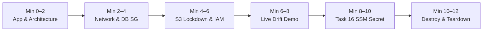

# 2DV705 Assignment 2: Live Demo Presentation Guide & Defense Script
## 10–12 Minute Live Examination Cheatsheet (Arch Linux & Hyprland)

> [!IMPORTANT]
> **Exam Format:** 10–15 minutes live demonstration with the course examiner/teaching assistant.
> **Core Objective:** You must demonstrate the live application, prove the security boundaries (firewall, IAM, S3 deny), demonstrate configuration drift, explain the Task 16 secret migration, and be prepared to predict what fails when a rule is intentionally broken.

---

## 1. Hyprland Screen Layout & Pre-Demo Setup

Before joining the defense session or sharing your screen, configure your Hyprland workspaces:

### Workspace 1 (Browser & Notes App)
* **Left Half:** Firefox displaying the live application:
  ```text
  http://51.21.246.81/
  ```
* **Right Half:** Browser tab on the health endpoint:
  ```text
  http://51.21.246.81/healthz
  ```

### Workspace 2 (Master Terminal: Arch Linux)
Split your terminal (Foot / Kitty / Alacritty) into two vertical panes:
* **Left Pane (Working Dir):** `~/AWS/lnu-notes/terraform` (for Terraform commands & code inspection)
* **Right Pane (Verification):** Quick-fire verification commands (curl, nc, aws s3, grep)

Ensure environment variables are active in both panes:
```bash
export AWS_PROFILE=2dv705
export AWS_DEFAULT_REGION=eu-north-1
```

---

## 2. Minute-by-Minute Live Presentation Flow



---

### Phase 1: Architecture & Application Walkthrough (Minutes 0:00 – 2:00)

#### What to Show
1. Switch to **Workspace 1** (Firefox).
2. Show the web application running at `http://51.21.246.81/`.
3. Create a live test note:
   * **Title:** `Live Exam Note`
   * **Body:** `Demonstrating automated cloud infrastructure on AWS Stockholm (eu-north-1)`
   * **Attach an Image:** Select any sample image and click **Save note**.
4. Point out the uploaded note and image on screen.
5. Click or show the `/healthz` tab:
   ```json
   {
     "app": "ok",
     "bucket": "2dv705-352445792625-notes",
     "database": "ok",
     "db_host": "10.0.2.171",
     "region": "eu-north-1",
     "s3": "ok"
   }
   ```

#### What to Say to the Examiner
> *"Here is the running application deployed in AWS Stockholm (`eu-north-1`). It consists of two EC2 `t3.micro` instances: a public web tier and a private database tier running MariaDB. Notes are stored in MySQL, and image attachments are stored in an S3 bucket.*  
> *Notice that the image rendered on the page is loaded through an expiring presigned URL generated by the instance's IAM role, proving the bucket itself does not need to be public."*

---

### Phase 2: Security as Code — Database Isolation (Minutes 2:00 – 4:00)

#### What to Show
1. Switch to **Workspace 2** (Terminal).
2. Display the database security group ingress rule in `main.tf`:
   ```bash
   sed -n '153,168p' main.tf
   ```
3. Run the dual verification in the right terminal pane:
   ```bash
   # Proof 1: Web tier reaches DB (via healthz)
   curl -s http://51.21.246.81/healthz | jq .database

   # Proof 2: Direct laptop access to DB port 3306 fails/times out
   nc -zvw 3 10.0.2.171 3306
   ```
   *Expected Output:*
   ```text
   nc: connect to 10.0.2.171 port 3306 (tcp) timed out: Operation now in progress
   ```

#### What to Say to the Examiner
> *"The database instance sits in a private subnet with no public IPv4 address and no route to the internet gateway. Its security group admits inbound TCP on port 3306 exclusively from the Web Security Group (`aws_security_group.web.id`), not from an IP address.*  
> *This binds firewall permissions to architectural role membership: if the web instance terminates or auto-scales, new instances automatically inherit access. As shown on the right, when my laptop attempts to probe port 3306 directly, packets are dropped and time out at the hypervisor boundary."*

---

### Phase 3: S3 Lockdown & Least Privilege IAM (Minutes 4:00 – 6:00)

#### What to Show
1. In the terminal, show the bucket policy and IAM role policy in `main.tf`:
   ```bash
   sed -n '222,267p' main.tf
   ```
2. Prove that administrator credentials from your laptop cannot write or read from the bucket:
   ```bash
   echo "Unauthorized test" > /tmp/test.txt
   aws s3 cp /tmp/test.txt s3://2dv705-352445792625-notes/test.txt
   ```
   *Expected Output:*
   ```text
   upload failed: ... An error occurred (AccessDenied) when calling the PutObject operation: ... with an explicit deny in a resource-based policy
   ```

#### What to Say to the Examiner
> *"The bucket has four layers of protection: S3 Block Public Access enabled in code, default AES-256 encryption, versioning, and an explicit resource-based bucket policy.*  
> *Even though my CLI profile holds `AdministratorAccess`, the bucket policy includes an explicit `Deny` on `s3:GetObject` and `s3:PutObject` for any principal other than the Web EC2 IAM role. In AWS evaluation logic, an explicit Deny overrides any Allow. The EC2 instance accesses the bucket without any stored static access keys, using temporary STS credentials provided by its instance profile."*

---

### Phase 4: Configuration Drift in Action (Minutes 6:00 – 8:00)

#### What to Show
1. Simulate drift live by disabling Block Public Access (either in the AWS console or via CLI in 1 second):
   ```bash
   aws s3api put-public-access-block \
     --bucket 2dv705-352445792625-notes \
     --public-access-block-configuration "BlockPublicAcls=false,IgnorePublicAcls=false,BlockPublicPolicy=false,RestrictPublicBuckets=false"
   ```
2. Reload `http://51.21.246.81/healthz`: Show that the app still reports `"s3": "ok"`.
3. In the terminal, run `terraform plan`:
   ```bash
   terraform plan
   ```
4. Point to the diff output on screen:
   ```text
   ~ resource "aws_s3_bucket_public_access_block" "notes" {
       ~ block_public_acls       = false -> true
       ~ block_public_policy     = false -> true
       ~ ignore_public_acls      = false -> true
       ~ restrict_public_buckets = false -> true
     }
   Plan: 0 to add, 1 to change, 0 to destroy.
   ```
5. Apply the fix:
   ```bash
   terraform apply -auto-approve
   ```

#### What to Say to the Examiner
> *"We introduced drift by disabling Block Public Access outside of Terraform. Notice two critical insights:*  
> *First, the application never broke because it uses signed URLs rather than public permissions.*  
> *Second, running `terraform plan` immediately detected the discrepancy between AWS real-world state and our declarative code. Rather than fixing it by hand in the console—which hides who changed what and bypasses review—we run `terraform apply` to let the code restore our security baseline."*

---

### Phase 5: Secret Management & Task 16 (Minutes 8:00 – 10:00)

#### What to Show
1. Show the secret in AWS SSM Parameter Store:
   ```bash
   aws ssm get-parameter --name /2dv705/db_password --with-decryption --query 'Parameter.Value' --output text
   ```
2. Prove that the database password no longer exists in `terraform.tfstate`:
   ```bash
   grep -c '"result"' terraform.tfstate
   ```
   *Expected Output:* `0`.
3. Show the SSM retrieval block inside `cloud-config-web.yaml.tftpl`:
   ```bash
   grep -A 12 "boto3.client(\"ssm\"" cloud-config-web.yaml.tftpl
   ```

#### What to Say to the Examiner
> *"Initially, Terraform generated the password using `random_password.db`. Even when marked `sensitive`, Terraform stores values in plain text inside `terraform.tfstate`.*  
> *In Task 16, we removed Terraform from handling the secret entirely: the password is stored as an encrypted `SecureString` in SSM Parameter Store. Both instances fetch it at boot over TLS using IAM instance profiles.*  
> *As verified here, `grep` returns 0 occurrences in `terraform.tfstate`. What remains uncovered is that any process with execution rights on the EC2 instances can still query SSM via the Instance Metadata Service (IMDS)."*

---

### Phase 6: Teardown & Clean Rebuild (Minutes 10:00 – 12:00)

#### What to Show
1. Run `terraform destroy`:
   ```bash
   terraform destroy -auto-approve
   ```
2. While resources are deleting, show the verification commands ready to prove a clean account:
   ```bash
   # Verify no running instances
   aws ec2 describe-instances --filters "Name=instance-state-name,Values=running,pending" --query 'Reservations[*].Instances[*].[InstanceId,State.Name]'

   # Verify bucket deletion
   aws s3 ls | grep 2dv705
   ```
3. Delete the SSM parameter:
   ```bash
   aws ssm delete-parameter --name /2dv705/db_password
   ```

---

## 3. The Examiner's "Break on Request" Prediction Matrix

During the exam, the examiner will ask you to **break one rule and predict what will fail before pressing enter**. Use this cheat sheet:

| The Examiner's Request | How to Break It | Your Prediction *Before* Pressing Enter | What `/healthz` Reports |
|---|---|---|---|
| *"Break access to the database"* | Remove the 3306 ingress rule in `main.tf` and apply, or delete rule via CLI: `aws ec2 revoke-security-group-ingress --group-id <db-sg> --protocol tcp --port 3306 --source-group <web-sg>` | *"Packets will be silently dropped by the security group stateful firewall. The connection will time out."* | `database: FAIL ... timed out` |
| *"Stop MariaDB without touching the firewall"* | SSH to DB or terminate service: `systemctl stop mariadb` | *"Packets will arrive at the OS, but no socket is listening on port 3306. It will return Connection Refused immediately, not timed out."* | `database: FAIL ... Connection refused` |
| *"Break S3 credentials"* | In `main.tf`, remove `iam_instance_profile = aws_iam_instance_profile.web.name` on web instance and apply | *"The instance will have no STS credentials. Boto3 will find no keys or role to sign requests."* | `s3: FAIL ... NoCredentialsError` |
| *"Break S3 authorization"* | In `task16-ssm.tf` or `main.tf`, change the bucket policy condition from `aws:SecureTransport = true` to `false` | *"A role is attached, but IAM policy evaluation will deny the request."* | `s3: FAIL ... AccessDenied` |
| *"Change the database password in SSM without updating instances"* | Run: `aws ssm put-parameter --name /2dv705/db_password --value "wrongpass" --overwrite` | *"Existing running connections stay active, but new boots or app restarts fail authentication."* | `database: FAIL ... Access denied for user 'lnu'` |

---

## 4. Emergency Troubleshooting During the Demo

If anything misbehaves during the live presentation, **do not panic or randomly edit files**. Diagnose out loud using `/healthz`:

1. **If `/healthz` reports `timed out`:**
   Check your security group:
   ```bash
   aws ec2 describe-security-groups --group-ids $(terraform output -raw db_sg_id)
   ```
2. **If `/healthz` reports `Connection refused`:**
   MariaDB is still initializing. Check cloud-init on the DB instance:
   ```bash
   ssh -i ~/.ssh/2dv705.pem ubuntu@$(terraform output -raw web_public_ip) "nc -zvw 2 $(terraform output -raw db_private_ip) 3306"
   ```
3. **If SSH times out:**
   Your public IP changed (e.g. Wi-Fi reconnection). Update `terraform.tfvars`:
   ```bash
   sed -i "s|admin_cidr.*|admin_cidr = \"$(curl -s https://checkip.amazonaws.com)/32\"|g" terraform.tfvars
   terraform apply -target=aws_security_group.web -auto-approve
   ```
